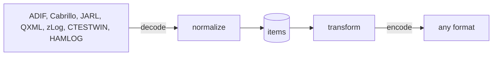
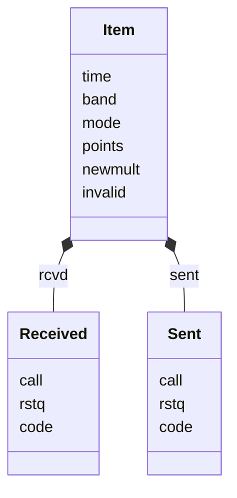
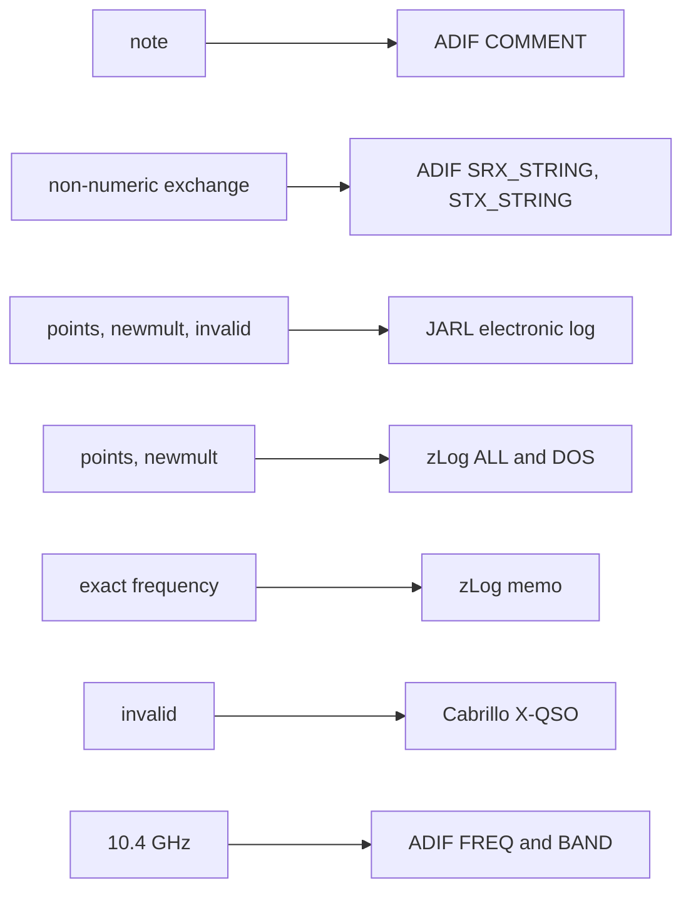
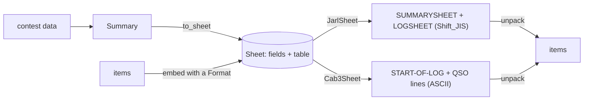
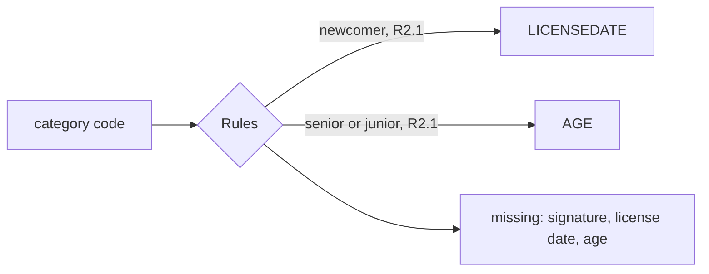

# RxSL


RxSL reads and writes amateur-radio log files.
It is the Rust version of [QxSL](https://github.com/autodyne/qxsl).



Every format meets in one model, so fields a format does not know survive a round trip.

## Model



Attributes are namespaced as in QXML: `qxsl.org` for the common ones and `adif.org` for ADIF fields.
The sent `call` is kept only by formats that have a field for it.

## Formats

| Module | Format |
|---|---|
| `adis`, `adxs` | ADIF (ADI, ADX) |
| `cqww` | Cabrillo, with zLog's header and columns |
| `jarl`, `jswl` | JARL electronic log, JARL SWL log |
| `qxml` | QXML |
| `zall`, `zdos` | zLog ALL and DOS text, in zLog's columns |
| `ctxt`, `cbin` | CTESTWIN text and LG8 |
| `hbin` | Turbo HAMLOG HDB |



Cabrillo and CTESTWIN LG8 cannot tell 10.4 GHz from 10 GHz.

## Sheets

A summary sheet wraps a log: ordered fields, then the log bytes of any format.



| Module | Sheet |
|---|---|
| `sheets::jarl` | JARL summary sheet R1.0 and R2.1, log in `<LOGSHEET>` |
| `sheets::cab3` | Cabrillo 3.0 header, log as `QSO:` lines |
| `sheets::summary` | JARL fields, score rows, tag order, category rules |

`cab3::header` writes every standard tag in order, empty or not.
Characters Shift_JIS or ASCII cannot hold become `?`; `Cab3Sheet { utf8: true }` writes UTF-8, and decoding accepts both.



## Usage

```toml
[dependencies]
rxsl = { git = "https://github.com/autodyne/rxsl" }
```

```rust
use rxsl::formats;

let adif = formats().into_iter().find(|f| f.kind() == "adis").unwrap();
let items = adif.read(bytes)?;
let text = adif.write(&items)?;

let mut sheet = summary.to_sheet();
sheet.embed(&rxsl::formats::jarl::Jarl::default(), &items)?;
let bytes = rxsl::sheets::jarl::JarlSheet.encode(&sheet)?;
let items = rxsl::sheets::unpack(&bytes)?;
```

## License

### Author

[無線部開発班](https://nextzlog.dev)

### Clauses

- This library is released under the [MIT License](LICENSE).
